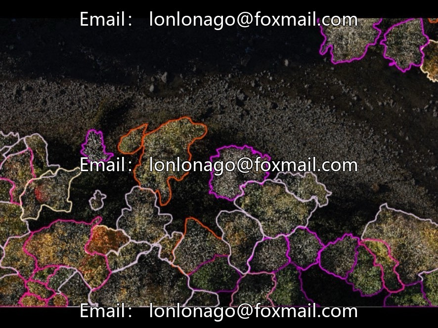
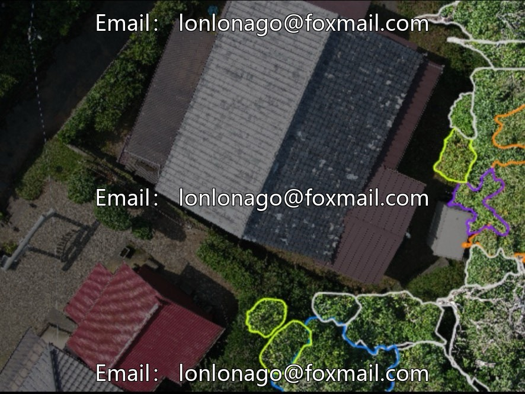
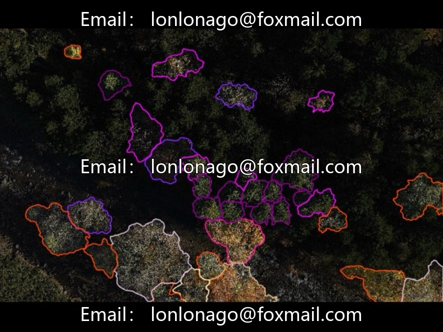
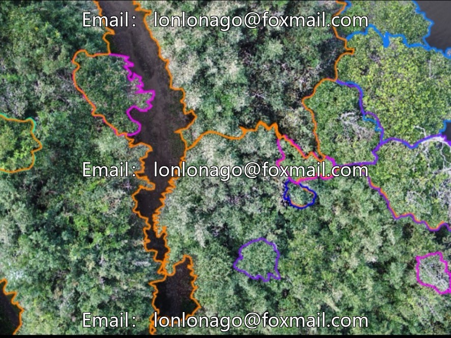

# Forestry instance segmentation dataset, compatible with YOLO-Seg, YOLO26, etc.

## Body

Forestry instance segmentation dataset, adaptable to algorithms like YOLO-Seg and YOLO26, specifically for drone intelligent forest inspection. Supports tree species classification and single/canopy segmentation. The dataset consists of 961 images, with 67 fine-grained annotation categories (numbered from 0 to 66). It is in the standard YOLO segmentation annotation format, directly usable without format conversion, suitable for the entire process of model training, validation, and testing.

Data characteristics
1. The image segmentation mask annotation files are structured and standardized, compatible with all series of YOLO instance segmentation models.
2.67-class fine-grained targets, covering forest tree categories and multi-scene general targets, supporting high-precision segmentation research and development.

Practical application value
1. Forestry field: UAV forest inspection, single-tree segmentation, canopy extraction, automatic tree species classification, empowering intelligent forest resource survey.
2. Multi-industry General: Autonomous driving environment instance segmentation, intelligent security target segmentation, robot vision obstacle navigation, medical imaging organ/lesion segmentation.
3. Research Purpose: Used as a benchmark dataset for instance segmentation algorithms, model optimization, performance comparison, and computer vision academic research.

Virtual materials, once sold, are non-refundable.
Interested friends, click "I want" to proceed.

## Images

## Payment

Here is a pay link on Stripe ( https://buy.stripe.com/3cs8yP7sY87d0vu9AB ). Please contact me lonlonago@foxmail.com after funding $89, and I will send you a complete data files , thank you!

